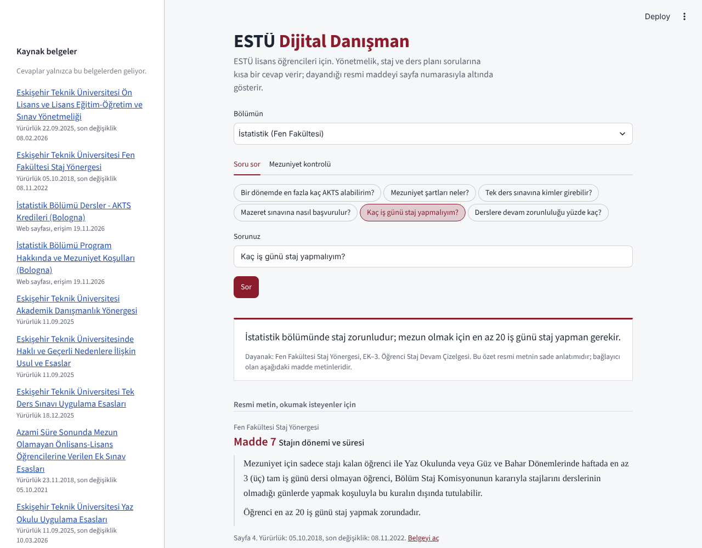

# ESTÜ Dijital Danışman

ESTÜ lisans öğrencilerinin "Kaç AKTS üst sınırım var?",
"Tek ders sınavına kimler girebilir?", "Kaç iş günü staj yapmam lazım?" gibi sorularına
**resmi belgelerden**, belge adı, madde numarası ve sayfasıyla cevap veren bir arama asistanı.

Önce sade dille kısa bir cevap veriyor, altında dayandığı resmi maddeleri olduğu gibi gösteriyor.
Kısa cevap, her madde için önceden elle yazılmış özet cümlelerinden seçiliyor; çalışırken yapay
zekâ ile metin üretilmiyor. Belgelerde cevap yoksa "bulamadım" diyor. Hiçbir ücretli API ya da
servis kullanmıyor.

**Hangi bölümler:** Öğrenci önce bölümünü seçiyor. Şu an 14 bölüm var: Fen Fakültesi (Biyoloji,
Fizik, İstatistik, Kimya, Matematik) ve Mühendislik Fakültesi (Bilgisayar, Çevre, Elektrik-Elektronik,
Endüstri, İnşaat, Kimya, Makine, Malzeme Bilimi, Uçak). Diğer fakülteler sırayla ekleniyor. Yönetmelik ve
usul-esaslar bütün lisans öğrencileri için ortak; staj yönergesi fakülteye, ders planı ve program
bilgileri bölüme özel. Bölüm seçilince arama sadece o bölüme uyan belgelerde yapılıyor
(`programlar.yaml`, belgelerdeki `kapsam` alanı).

"Mezun olmak için neyim eksik?" sorusu için ayrı bir **mezuniyet kontrolü** sekmesi var:
tamamlanan AKTS, GNO, kalan FF/YZ/DZ/EK/ÇK notları ve staj gününü girince yönetmeliğin
25. maddesine ve bölümün staj kuralına göre neyin eksik olduğunu, maddesiyle birlikte gösteriyor.

**Canlı:** https://estu-dijital-danisman.streamlit.app



## Kaynak belgeler

Hepsi resmi sitelerden indirildi (`kaynaklar/`, ayrıntılar ve indirme tarihleri `belgeler.yaml`).

| Belge | Yürürlük | Son değişiklik |
|---|---|---|
| Ön Lisans ve Lisans Eğitim-Öğretim ve Sınav Yönetmeliği (RG 33012) | 22.09.2025 | 08.02.2026 (RG 33162) |
| Fen Fakültesi Staj Yönergesi | 05.10.2018 | 08.11.2022 |
| Mühendislik Fakültesi Staj Yönergesi | 04.12.2018 | 16.07.2024 |
| Akademik Danışmanlık Yönergesi | 11.09.2025 | |
| Haklı ve Geçerli Nedenlere İlişkin Usul ve Esaslar | 11.09.2025 | |
| Tek Ders Sınavı Uygulama Esasları | 18.12.2025 | |
| Ek Sınav Esasları (azami süre sonu) | 23.11.2018 | 05.10.2021 |
| Yaz Okulu Uygulama Esasları | 11.09.2025 | 10.03.2026 |
| Not Karşılıkları ve Yabancı Dil Eşdeğerlikleri Uygulama Esasları | 10.07.2018 | 29.07.2025 |
| Proje Temelli Staj Yönergesi | 04.01.2024 | 26.06.2025 |
| 14 bölümün ders planları ve program bilgileri (Bologna sayfaları) | web sayfası | |

Not: Yönetmelik 2025'te tamamen yenilendi. İnternette hâlâ 2018 tarihli eski metin (RG 30540)
dolaşıyor; buradaki metin mevzuat.gov.tr'deki güncel, değişiklikleri işlenmiş hali.

## Nasıl çalışıyor

```
kaynaklar/*.pdf, *.html
   │  ayristir.py   madde madde parçalama (MADDE 10-, 1), 1- ...), sayfa ve başlık bilgisi
   ▼
cikti/parcalar.jsonl  (267 parça, her birinde kapsam: genel / fakülte / bölüm)
   │  indeks.py     e5-small (ONNX, int8) ile vektörler + FAISS, BM25 için Türkçe kök
   ▼
indeks/
   │  arama.py      seçilen bölümün belgelerinde BM25 + e5 + özet benzerliği, Reciprocal Rank Fusion
   │  cevap.py      kısa cevap (ozetler.yaml'dan cümle seçimi) + ilgili fıkralar + atıf
   │                + "bulamadım" eşiği
   ▼
app.py (Streamlit)
```

Birkaç ayrıntı:

- **Madde bazlı parçalama.** Sabit uzunlukta bölmek yerine her madde (ya da usul ve esaslardaki
  numaralı bent) ayrı parça. Böylece cevapta "Madde 10, s. 3" diye kaynak gösterilebiliyor.
- **Tablolar** `a | b | c` satırları olarak tutuluyor. Görüntü olarak eklenmiş tablolar okunamadığı
  için "bu sayfaya bakın" diye işaretli.
- **Taranmış PDF.** Ek Sınav Esasları'nın metin katmanı yok, `tesseract` ile okundu ve not dönüşüm
  tablosu görüntüye bakılarak elle düzeltildi (`kaynaklar/ek_sinav_esaslari.ocr.txt`).
- **Model.** [intfloat/multilingual-e5-small](https://huggingface.co/intfloat/multilingual-e5-small)
  modelinin int8 ONNX hali (~118 MB). CPU'da çalışıyor, ilk açılışta Hugging Face'ten ücretsiz iniyor.
  Tokenizer, Hugging Face `tokenizer.json`'ın SentencePiece'e çevrilmiş hali (`indeks/tokenizer.model`,
  `tokenizer_donustur.py`): aynı token id'lerini veriyor ama bellekte ~300 MB yerine ~70 MB tutuyor.
  Uygulamanın toplam belleği ~290 MB, bir soru ~0,01 sn.
- **"Bulamadım".** En iyi parçanın benzerliği 0.850'nin üstündeyse cevap gösteriliyor, 0.825'in
  altındaysa "bulamadım" deniyor, arada kalırsa "kesin cevap bulamadım, ilgili olabilecek maddeler" deniyor.
- **Kısa cevap.** `ozetler.yaml`'da her parça için sade özet cümleleri var (207 parça, 450 cümle,
  elle yazıldı). Ders planları tablo olduğu için onların cümleleri tablodan otomatik üretiliyor
  ("Fizik bölümünde 1. yarıyılın zorunlu dersleri şunlardır: ..."). Soruya göre en iyi 5 parçanın
  cümleleri puanlanıyor (e5 benzerliği + kelime örtüşmesi + maddenin benzerliği) ve en uygun 1-3 cümle
  gösteriliyor. Vektörler `indeks/ozet_vektorleri.npz`'de; özetler değişirse ilk soruda kendiliğinden
  yeniden hesaplanıyor (~5 sn).
- **Bölüm seçimi.** Arama sadece genel belgeler + bölümün fakültesinin staj yönergesi + bölümün Bologna
  sayfalarında yapılıyor, BM25 her bölüm için ayrı kuruluyor. Bölümün kendi sayfalarının arama metninde
  bölüm adı yazmıyor, yoksa "Kimya bölümünde staj zorunlu mu?" gibi her soruda ders planı öne çıkıyor.
- **Özet sıralaması.** Özetler öğrencinin kullandığı kelimelerle yazıldığı için, soruya en yakın özet
  cümlesinin benzerliği aramaya üçüncü bir sıralama olarak ekleniyor. "Bulamadım" kararı yine madde
  metnine bakıyor.
- **Bölüme özel staj kuralı.** Staj yönergesindeki madde genel ("en az 20 iş günü", "toplam en az 40
  gün"); hangi bölümde zorunlu olduğu ya da bölümün ayrıntısı başka yerde (Fen'de ekteki not, Endüstri ve
  Elektrik-Elektronik'te Bologna sayfası). Her bölüme `programlar.yaml`'dan kendi staj cümlesi ekleniyor,
  sadece o bölüm seçiliyken kullanılıyor. Soru stajın süresini ya da zorunluluğunu soruyorsa bu cümle
  doğrudan ilk sırada; mezuniyet kontrolü de aynı bilgiyi kullanıyor.
- **Standart Bologna metinleri.** Bölüm sayfalarındaki "kabul koşulları", "ölçme ve değerlendirme" gibi
  çoğu bölümde aynı olan metinlerin özetleri şablondan üretiliyor, farklı olanlar elle yazıldı.

## Sonuçlar

Test setleri `tests/` altında, her sorunun cevabı belgelerden kontrol edildi.

**Arama** (doğru kaynak ilk k sonuçta mı):

| Set | hit@1 | hit@3 | hit@5 | MRR |
|---|---|---|---|---|
| Ana set (İstatistik, 27 cevaplı soru) | 0.74 | 0.96 | 0.96 | 0.85 |
| Ayrık set (İstatistik, 10 cevaplı, ayarlamada kullanılmadı) | 0.90 | 1.00 | 1.00 | 0.95 |
| Doğrulama seti (İstatistik, 8 cevaplı) | 0.88 | 1.00 | 1.00 | 0.92 |
| Fen Fakültesi diğer bölümler (16 cevaplı) | 0.69 | 0.81 | 0.88 | 0.78 |
| Mühendislik Fakültesi (18 cevaplı) | 0.61 | 0.78 | 0.89 | 0.73 |

Hibrit arama bütün setlerde sadece BM25'ten ve sadece e5'ten daha iyi ya da eşit.

**Cevap** (cevaplı soruda beklenen ifade gösterilen alıntıda geçiyor mu, cevapsız soruda
asistan cevap bulduğunu iddia etmiyor mu):

| Set | Cevaplı | Cevapsız |
|---|---|---|
| Ana set | 26/27 | 3/3 |
| Kalibrasyon (sadece cevapsız) | | 14/15 |
| Ayrık set | 10/10 | 2/2 |
| Doğrulama (eşikten sonra yazıldı) | 8/8 | 6/8 |
| Fen Fakültesi diğer bölümler | 13/16 | 1/2 |
| Mühendislik Fakültesi | 14/18 | 1/2 |

**Kısa cevap** (dayandığı maddelerden biri doğru kaynak mı): ana set 24/27, ayrık set 10/10,
doğrulama 8/8, Fen diğer bölümler 14/16, Mühendislik 17/18.

Fen ve Mühendislik setlerinde cevabı olmayan ikişer sorudan birine ("laboratuvar önlüğü nereden
alınır?", "kantin nerede?") hâlâ "bulundu" deniyor. Belge sayısı arttıkça "bulamadım" eşiği zayıflıyor,
tekrar ayarlanması gerekecek.

Ayrıntılar ve hatalı sorular: [raporlar/4_arama.md](raporlar/4_arama.md),
[raporlar/5_cevap.md](raporlar/5_cevap.md). Parçalama kontrolleri:
[raporlar/2_ayristirma.md](raporlar/2_ayristirma.md).

## Kurulum

Python 3.12 ya da 3.13 (sabitlenen numpy sürümü 3.12+ istiyor).

```bash
git clone https://github.com/beratciftci4/ESTU-Dijital-Danisman.git
cd ESTU-Dijital-Danisman
pip install -r requirements.txt
streamlit run app.py
```

İndeks repoda hazır geliyor, model ilk çalıştırmada `model/` klasörüne iniyor.

Belgeler değişirse:

```bash
python belge_kontrol.py   # belge listesi, tarihler ve sha256 kontrolü
python ayristir.py        # parçaları yeniden üret
python indeks.py          # indeksi yeniden kur
python degerlendir.py     # test setleriyle ölç, raporlar/ güncellenir
pytest                    # 97 test
```

## Ücretsiz yayınlama (Streamlit Community Cloud)

1. https://share.streamlit.io adresine GitHub hesabıyla gir.
2. **Create app** → bu repo, `main` dalı, dosya `app.py`.
3. **Advanced settings** → Python sürümü olarak 3.12 ya da 3.13 seç.
4. **Deploy**. Kart bilgisi istemiyor; ücretsiz planda çalışıyor.

API anahtarı ya da gizli bilgi gerekmiyor.

## Sınırlar

- Bu bir arama aracı, **resmi görüş değil**. Kesin bilgi için Öğrenci İşleri'ne ya da akademik
  danışmana sorun.
- Sadece yukarıdaki belgeleri biliyor. Akademik takvim, burs, yurt, Erasmus gibi konular yok.
- Benzerlik eşiği tek başına mükemmel değil: belgelerdeki kelimelere yakın ama kapsam dışı
  bir soru (örneğin "mezunlar derneği") bazen eşiği geçebiliyor. Bu durumda bile gösterilen
  metin resmi metnin aynısı, kaynak ve sayfası yazılı.
- Bologna sayfalarının yürürlük tarihi yok, erişim tarihi esas alınıyor.
- Bologna sayfaları bölümler tarafından dolduruluyor ve bazen kendi içinde tutarsız (Fizik ve
  Matematik sayfalarında kredi transferi başvurusu hem "ilk hafta" hem "ilk iki hafta" yazıyor).
  Özette bu durum belirtiliyor, bölüme sormak gerekiyor.
- Bölüm adı Bologna sayfasından geliyor; Pilotaj ve diğer fakülteler henüz eklenmedi.
- Mühendislik'te stajın bölüme göre nasıl bölündüğü (Staj I / Staj II) bölümlerin staj kılavuzlarında;
  kılavuzlar eklenmediği için sadece toplam süre ve Bologna sayfasında yazan ayrıntı veriliyor.
  Uçak Mühendisliği yönergenin bölüm listesinde adıyla geçmiyor.
- Kısa cevap madde metninin sade anlatımı; bağlayıcı olan altındaki resmi metin. Bazen soruya
  tam uymayan bir cümle seçilebiliyor, bu yüzden kaynak maddeler her zaman altında gösteriliyor.
- Özetler elle yazıldığı için bir belge güncellenince `ozetler.yaml`'daki cümleleri de
  güncellemek gerekiyor (testler her parçanın özeti olduğunu kontrol ediyor).

## Dosyalar

| Dosya | Ne yapıyor |
|---|---|
| `belgeler.yaml` | Belge listesi: URL, yürürlük, son değişiklik, sha256 |
| `belge_kontrol.py` | Belge listesini ve dosyaları kontrol eder |
| `ayristir.py` | Belgeleri madde/bent parçalarına ayırır |
| `indeks.py` | Embedding modeli, BM25 kelime ayırma, FAISS indeksi |
| `tokenizer_donustur.py` | tokenizer.json'ı küçük SentencePiece modeline çevirir |
| `arama.py` | Hibrit arama |
| `programlar.yaml` | Bölümler, fakülteleri, Bologna numaraları ve staj süreleri |
| `cevap.py` | Kısa cevap, atıflı alıntılar ve "bulamadım" kararı |
| `ozetler.yaml` | Her madde için elle yazılmış sade özet cümleleri |
| `mezuniyet.py` | Mezuniyet koşulları kontrolü |
| `degerlendir.py` | Test setleriyle ölçüm, `raporlar/` |
| `app.py` | Streamlit arayüzü |
| `tests/` | Testler ve soru setleri |
